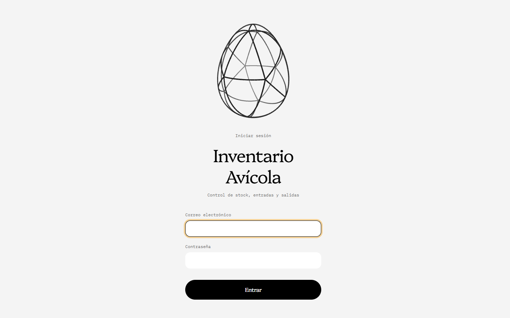
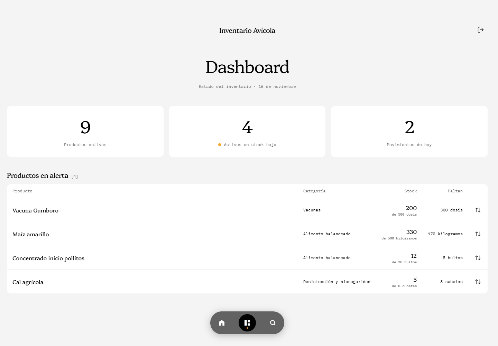

# Inventario Avícola

Una página web para controlar los productos de un negocio avícola: qué entra, qué sale y qué falta.


*La pantalla de entrada, con el huevo en 3D.*

**Pruébalo sin instalar nada.** Entra a la demo, una copia de prueba en internet: [inventario-avicola.vercel.app/login](https://inventario-avicola.vercel.app/login). Usa las [cuentas de demostración](#cuentas-de-demostración). Puedes crear productos, registrar movimientos y más. Los datos vuelven al inicio cuando la demo se apaga, tras unos 5 minutos sin visitas. No escribas datos reales.

## ¿Qué es?

Es como el cuaderno de la bodega, pero en el computador: ahí anotas lo que entra y sale. La app lleva la cuenta de lo que queda y te avisa cuando algo se acaba.

**Para quién es.** Para negocios avícolas que guardan alimento, vacunas o insumos.

## Qué puedes hacer

- **Registrar entradas y salidas.** La cantidad de cada producto se actualiza sola.
- **Recibir avisos de stock bajo.** El stock es lo que queda de un producto; si baja del mínimo, la app avisa.
- **Ver el resumen del día.** Productos activos, los que se acaban y los movimientos de hoy.
- **Consultar el historial.** Por producto, por tipo o entre dos fechas.
- **Imprimir reportes.** Por categoría, de productos por reponer y de los más movidos.
- **Repartir el trabajo con dos roles.** El administrador maneja productos, categorías y cuentas; el encargado de inventario registra movimientos.


*El resumen: tres números clave y los productos por reponer.*

## Cuentas de demostración

Son datos de prueba públicos, solo para desarrollo. Sirven para la demo y para tu computador.

| Rol | Correo | Contraseña |
|---|---|---|
| Administrador | `admin@test.com` | `12345678` |
| Encargado de inventario | `encargado@test.com` | `12345678` |

## Cómo probarlo en tu computador

Estos pasos son para Windows y usan PowerShell, una ventana donde se escriben órdenes. Usarás Docker, un programa que prepara todo lo que la app necesita. Docker la reparte en contenedores: cajas aisladas, una para cada parte.

### Antes de empezar

Necesitas tener instalado:

| Programa | Para qué sirve | Cómo saber si ya lo tienes |
|---|---|---|
| [Docker Desktop](https://www.docker.com/products/docker-desktop/) | La versión de Docker para Windows. | En PowerShell, escribe `docker version`: debe aparecer un número de versión. |

También necesitas unos 2 GB libres (GB: la medida del espacio en el disco). Lo ves en **Este equipo**.

> **Qué es la terminal.** Una ventana donde se escriben órdenes. En Windows se llama PowerShell: búscala en el menú Inicio.
> **Cómo usarla.** Copia la orden de esta página (el README). Pégala en la ventana con Ctrl + V (las teclas Control y V a la vez) y pulsa Enter. No necesitas entenderla: cópiala tal cual. Si algo sale mal, aparece un mensaje que suele incluir la palabra «error».

Si te falta algún programa, descárgalo desde su enlace, ábrelo y sigue los pasos del instalador.

### Pasos

1. **Descarga el proyecto.** En la página de este proyecto en GitHub (donde estás leyendo esto), pulsa el botón verde **Code**. Luego elige **Download ZIP**. Se descarga un archivo comprimido (.zip): haz clic derecho sobre él y elige **Extraer todo**. Se crea una carpeta con el mismo nombre: esa es la carpeta del proyecto.
2. **Abre Docker Desktop.** Búscalo en el menú Inicio y déjalo abierto. Vas bien si no aparece ningún mensaje de error.
3. **Abre PowerShell en la carpeta del proyecto.** En el Explorador de archivos, entra a la carpeta. Haz clic derecho en un espacio vacío y elige **Abrir en Terminal**. Vas bien si se abre una ventana para escribir.
4. **Crea las claves de la app.** Solo la primera vez: crea sus contraseñas internas, sin mostrarlas. En PowerShell, escribe:
   ```
   powershell -ExecutionPolicy Bypass -File scripts\docker-init.ps1
   ```
   Vas bien si aparece `Creado .env.docker.app (APP_KEY y DB_PASSWORD nuevos).`
5. **Arranca la app.** La primera vez tarda unos minutos. En PowerShell, escribe:
   ```
   docker compose up -d --build
   ```
   Vas bien si no aparece ningún mensaje de error.
6. **Espera a que esté lista.** Esta orden muestra cada contenedor:
   ```
   docker compose ps
   ```
   Vas bien si `db` y `web` dicen `healthy` (sana). La primera vez tarda unos 30 segundos.
7. **Carga los datos de demostración.** Crea la base de datos, donde la app guarda su información:
   ```
   docker compose exec app php artisan migrate --seed --force
   ```
   Vas bien si al final aparece `Stock verificado: coincide con el historial…`.
8. **Abre la app.** Escribe en la barra de arriba de tu navegador:
   ```
   http://127.0.0.1:8080
   ```
   127.0.0.1 es «este mismo computador» y 8080, el puerto: la «puerta» de la app. Vas bien si aparece la pantalla de entrada.

### ¿Cómo sé que funcionó?

Entra con una [cuenta de demostración](#cuentas-de-demostración): verás el inicio de tu rol. Para apagarla, escribe `docker compose down`; para prenderla, `docker compose up -d`.

### Si algo falla

- **PowerShell no reconoce `docker`.** Abre o instala Docker Desktop y repite el paso.
- **El paso 5 muestra `additional privileges requested`.** Cierra PowerShell y ábrelo como dice el paso 3.
- **La página no abre y `app` se reinicia sin parar.** Falta el paso 4: hazlo y escribe `docker compose up -d`.

La guía técnica completa está en [docs/docker.md](docs/docker.md).

## Con qué está hecho

Esta parte es para quien sabe de programación: no la necesitas para usar el proyecto.

- **Laravel 12.** Una caja de herramientas para crear páginas web con PHP, un lenguaje de programación.
- **MySQL y Docker.** La base de datos y los tres contenedores: páginas, app y datos.
- **Three.js.** Una biblioteca (piezas ya hechas) que dibuja el huevo en 3D.

## Estado del proyecto

Terminado (versión 1): todo lo descrito aquí funciona. Queda para el futuro, por ejemplo, guardar reportes en PDF o Excel.

## Autor y licencia

Hecho por Emanuel ([github.com/banna-nuel](https://github.com/banna-nuel)).

Licencia MIT ([LICENSE](LICENSE)): puedes usar, copiar, modificar y compartir este proyecto si mantienes el aviso de autoría y de licencia.

## Palabras que quizá no conozcas

- **127.0.0.1.** Tu propio computador funcionando como sitio web, solo para ti.
- **Archivo comprimido (.zip).** Un archivo que guarda muchos archivos juntos y en menos espacio.
- **Base de datos.** El lugar donde la app guarda su información.
- **Biblioteca.** Un conjunto de piezas ya hechas que un programa usa.
- **Contenedor.** Una caja aislada donde funciona una parte de la app.
- **Demo.** Una copia de prueba de la app en internet.
- **Docker.** Un programa que prepara en tu computador todo lo que la app necesita.
- **GB (gigabyte).** La medida del espacio en el disco.
- **GitHub.** Una página web para guardar y compartir proyectos.
- **Laravel.** Una caja de herramientas para crear páginas web con PHP.
- **Lenguaje de programación.** Un idioma para darle instrucciones al computador.
- **Licencia.** El permiso que dice qué pueden hacer otros con un proyecto.
- **MySQL.** El programa de base de datos donde la app guarda su información.
- **Navegador.** El programa con el que ves páginas web.
- **PHP.** El lenguaje de programación de muchas páginas web.
- **PowerShell (terminal).** Una ventana donde se escriben órdenes.
- **Puerto.** El número de «puerta» por donde entra una conexión.
- **Stock.** La cantidad que queda de un producto.
- **Three.js.** Una biblioteca para dibujar objetos en 3D dentro del navegador.
