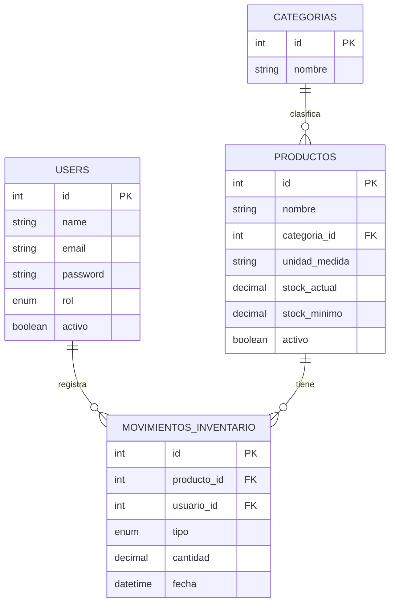

# Sistema de Gestión de Inventario — Modelo de Datos

**Versión:** 1.0
**Motor:** MySQL

---

## 1. Diagrama Entidad-Relación

## 2. Diccionario de Datos

### `users`

Tabla estándar de Laravel (ya existía); se le agregaron `rol` y `activo` con una migración. Se omiten las columnas internas de Laravel (`email_verified_at`, `remember_token`).

| Campo | Tipo | Restricciones |
|---|---|---|
| id | BIGINT | PK, autoincremental |
| name | VARCHAR(255) | NOT NULL |
| email | VARCHAR(255) | NOT NULL, UNIQUE |
| password | VARCHAR(255) | NOT NULL (se guarda con hash automáticamente por el cast `hashed` del modelo `User`) |
| rol | ENUM('admin', 'encargado') | NOT NULL |
| activo | BOOLEAN | DEFAULT true |
| timestamps | created_at, updated_at | |

### `categorias`

| Campo | Tipo | Restricciones |
|---|---|---|
| id | BIGINT | PK, autoincremental |
| nombre | VARCHAR(100) | NOT NULL, UNIQUE |
| timestamps | created_at, updated_at | |

### `productos`

| Campo | Tipo | Restricciones |
|---|---|---|
| id | BIGINT | PK, autoincremental |
| nombre | VARCHAR(150) | NOT NULL |
| categoria_id | BIGINT | FK → categorias.id |
| unidad_medida | VARCHAR(20) | NOT NULL (ej: "libras", "kg", "unidades") |
| stock_actual | DECIMAL(10,2) | DEFAULT 0 |
| stock_minimo | DECIMAL(10,2) | NOT NULL |
| activo | BOOLEAN | DEFAULT true |
| timestamps | created_at, updated_at | |

### `movimientos_inventario`

| Campo | Tipo | Restricciones |
|---|---|---|
| id | BIGINT | PK, autoincremental |
| producto_id | BIGINT | FK → productos.id |
| usuario_id | BIGINT | FK → users.id |
| tipo | ENUM('entrada', 'salida') | NOT NULL |
| cantidad | DECIMAL(10,2) | NOT NULL |
| fecha | DATETIME | DEFAULT now() |
| timestamps | created_at, updated_at | |

## 3. Reglas de Integridad

- `productos.categoria_id` no puede ser nulo; toda categoría debe existir antes de asignarse.
- No se permite eliminar físicamente `productos` ni `users` con movimientos asociados — se usa `activo = false` (soft delete lógico).
- Toda escritura en `movimientos_inventario` debe ejecutarse dentro de una transacción que también actualice `productos.stock_actual`, para evitar desincronización.
- En movimientos de tipo `salida`, se valida `cantidad <= stock_actual` antes de confirmar.

## 4. Equivalencia con Migraciones Laravel

Este modelo se traduce a 4 migraciones de Laravel: una que agrega `rol` y `activo` a `users`, y las de `categorias`, `productos` y `movimientos_inventario`, cada una con sus llaves foráneas vía `foreignId()->constrained()`.
